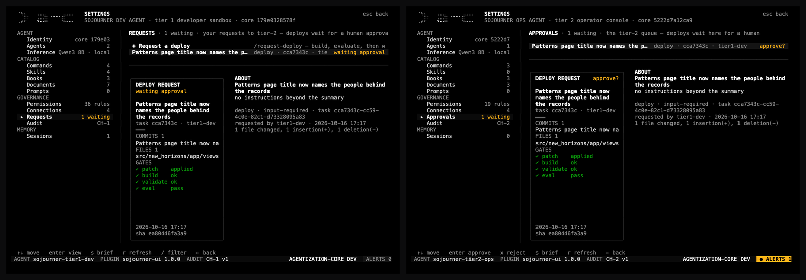
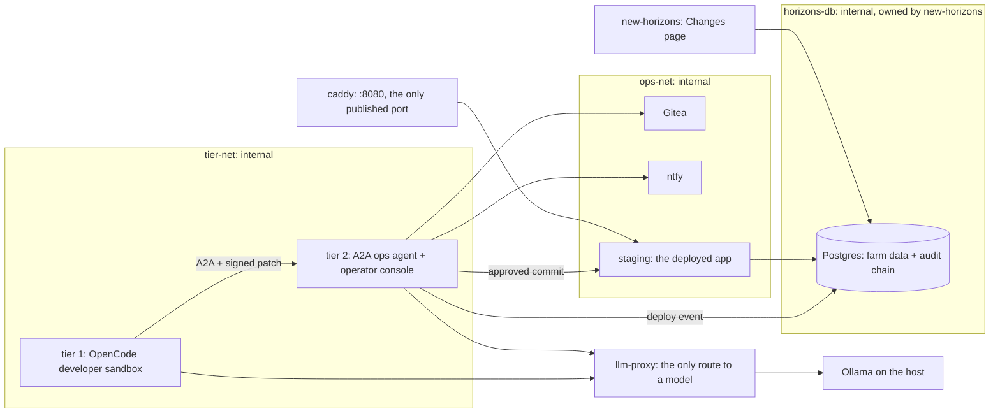
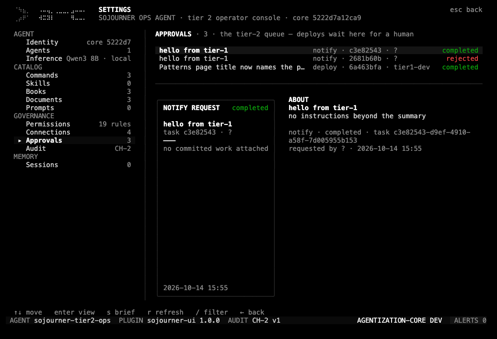
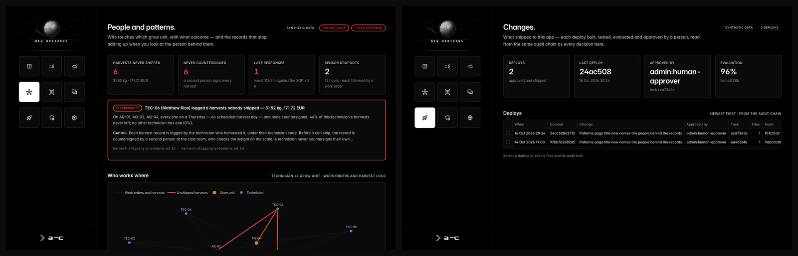

# sojourner

**Sojourner** is a two-tier governed developer harness. A coding agent works in a sealed
sandbox; an operations agent builds, validates and evaluates what it hands over; a person
approves; the change ships to staging and is recorded in the same hash-chained audit log the
application itself reads. The project it works on is real:
[new-horizons](https://github.com/Omisoman/new-horizons), an offline analytics
agent for an aquaponics farm.



## What it does

- **Tier 1: the developer sandbox.** OpenCode with a farm-specific developer agent, books
  (architecture, coding standards, release playbook) and skills (`streamlit-view`,
  `analytics-module`, `kb-document`, `a2a-delegate`). Read-only root filesystem, no
  capabilities, **no network** except one proxy to the model, no credentials. Its workspace
  is a clone of new-horizons; it runs the suite and the import contracts offline. The
  only way out is an A2A call carrying a hash-identified `git format-patch` of its commits.
- **Tier 2: the operator.** An A2A server whose pipeline order is code, not model
  discretion: replay the patch on a clean baseline → Gitea PR → **build** (lock unchanged,
  nothing new to install, hermetic suite) → **validate** (import contracts, knowledge-base dry
  run, business-truth tests, every page rendered on the real data) → **evaluate** (the
  bilingual question set on a second model, against a threshold the patch cannot touch) →
  waits for a human. After approval: **deploy** the exact commit to staging, **notify**, and
  write one `deploy` event into the app's audit chain.
- **One record per agent.** `tier{1,2}/core.json` is the agent: identity, model, persona,
  catalog, permissions, connections, audit channel. OpenCode's config is compiled from it and
  the console shows its signature.

Measured on one MacBook: request → approval gate **87 s** (build 7 s, validate 9 s,
26-question scorecard 44 s at 96 % against a 75 % bar); approval → staging serving the new
commit **54 s**. A change that broke a page only on real data passed tier 1's sandbox and the
model-graded evaluation, and was refused by validate in 81 s, before anyone was asked to
approve it ([docs/DEMO.md](docs/DEMO.md)).

## Architecture



Walls are topology, not prompts: every network a container running agent-driven or
agent-written code sits on is `internal: true`; `make demo2-verify` proves egress is blocked
three ways (HTTPS, DNS, git) in tier 1, tier 2 and staging. Tier 2's server imports the
**baked** baseline, so a patch can change the app but never the gate that judges it: the
question set, the grader and the threshold come from the baseline too. The approval is a JWT
role checked against the access rules; the deploy event is written by server code from that
JWT, never from model output. See [SECURITY.md](SECURITY.md).

## Run

Needs the sibling checkout at `../new-horizons` (set up per its README: `make db-up
mock kb`), Docker, tmux, [uv](https://docs.astral.sh/uv/), [Bun](https://bun.sh) and Ollama
(`source ../new-horizons/scripts/ollama-env.sh && ollama serve`). Never run New Horizons'
`make demo1` at the same time: the budget is 16 GB.

```sh
uv sync                                   # resolves new-horizons from ../ (git URL in CI)
make demo2-build && make demo2-reset      # the tier image bakes New Horizons' checkout + data
make demo2-up                             # New Horizons' Postgres, then the stack, then Gitea's baseline
make demo2-verify                         # walls + wiring: must say "all checks passed"
make demo2-attach                         # terminal 1: the developer sandbox
make demo2-ops                            # terminal 2: the operator console
open http://localhost:8080                # staging: the deployed app
```

`make test` (records, patch channel, tier-2 tools, compose walls, lock parity, TUI, brand) ·
`make lint` (generated files match their generators, client-free) · `bun test` in
`infra/tui`.

## Models (not in this repo)

No model weights are in this repository. `make models` in `../new-horizons` pulls these from Ollama; the first run needs roughly 20 GB of disk and a machine with 16 GB RAM (24 GB for all five at once).

| Model | Role | Download | Ollama |
|---|---|---|---|
| `qwen3:8b` | drives both tiers: the tier-1 developer agent and the tier-2 operator | 5.2 GB | [ollama.com/library/qwen3:8b](https://ollama.com/library/qwen3:8b) |
| `llama3.1:8b` | the evaluate gate: scores New Horizons' bilingual question set on every change | 4.9 GB | [ollama.com/library/llama3.1:8b](https://ollama.com/library/llama3.1:8b) |

`infra/scripts/deepseek-tools.Modelfile` builds `deepseek-r1-tools:8b` (`make deepseek-tools`):
deepseek-r1:8b's weights under qwen3's tool-call template, an optional entry in the tiers'
model list and never the default. Serve Ollama with New Horizons'
[`scripts/ollama-env.sh`](https://github.com/Omisoman/new-horizons/blob/main/scripts/ollama-env.sh)
(8192-token context, q8_0 KV cache).

## Data

Sojourner has no data of its own. Its staging target is New Horizons, which runs on the synthetic aquaponics dataset described in [`../new-horizons/README.md#data`](https://github.com/Omisoman/new-horizons#data). No client data, names, branding or configuration are in this repository; the dataset and the staging target are the synthetic New Horizons farm.

## Example

In terminal 1, ask the developer agent:

> Read `src/new_horizons/app/views/patterns.py` with offset 28 and limit 4, change the
> title `tr("Patterns.", "الأنماط.")` to `tr("People and patterns.", "الأشخاص والأنماط.")`,
> commit, then `/request-deploy`.

It commits one line, runs the suite and the contracts, and hands the patch to tier 2. In
terminal 2, **ALERTS → Approvals** shows the commit, the file and the gates (patch · build ·
validate · eval); confirm.



Under a minute later (54 s measured) staging's Patterns page reads *People and patterns.*,
and the app's **Changes** page lists the deploy: commit, approver, task, and the evaluation
score on llama3.1:8b.



## Stack

OpenCode 1.18.30 (TUI plugin in Solid/OpenTUI, run by Bun) · a2a-sdk (JSON-RPC, JWT bearer)
· LangGraph with a JSON tool protocol · Python 3.12 + uv (offline, frozen) · Ollama 8B
models (qwen3:8b drives both tiers, llama3.1:8b gates) · Postgres 16 · Gitea · ntfy · Caddy ·
socat · Docker Compose. An optional LiteLLM gateway serves a Claude lane, keeping the key out
of every tier. Synthetic data, no real company or person.

## Author

Omar Soman, Software Engineer, Agentic AI Systems, author of Agentization Core. [github.com/Omisoman](https://github.com/Omisoman), [agentization-core.com](https://agentization-core.com), [linkedin.com/in/omarsoman](https://www.linkedin.com/in/omarsoman).

## License

MIT licensed, see [LICENSE](LICENSE).
